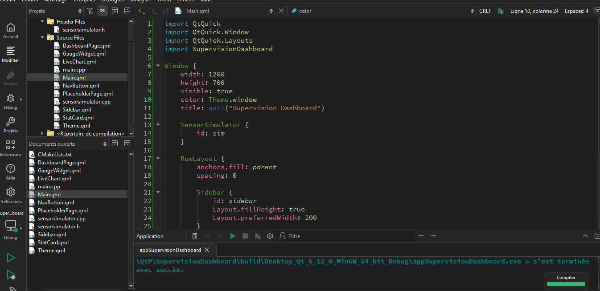
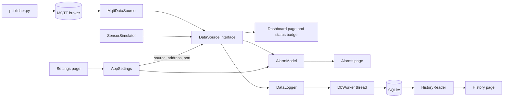

# Supervision Dashboard


A supervision dashboard for industrial installations, built with C++17 and Qt 6 (QML). It monitors voltage, current, power and temperature in real time with live charts and gauges.

The measurements come from a built-in simulator (no hardware required) or from a real device publishing over **MQTT**. The rest of the application does not know the difference.

* **Dashboard**: live values, charts, a temperature gauge and a connection status badge.
* **History page**: browse each quantity over a chosen time range on a line chart, and export the data to a CSV file.
* **Alarms page**: when a quantity crosses a threshold, the alarm log records the quantity, the time and the value. Once you have reviewed an alarm, you can acknowledge it.
* **Settings page**: set the warning and critical limits for each quantity, and choose the data source (Simulator or MQTT). Your settings are saved for the next launch.



## Features

* Real-time monitoring of voltage, current, power and temperature
* **Interchangeable data source**: built-in simulator or MQTT, selected in the Settings page
* **Connection indicator**: *Live*, *Connecting...*, *Broker unreachable*, *Device offline* or *No data*, with values dimmed when the data is not live
* **Silent device detection**: a watchdog flags a device that stops sending measurements, in addition to the MQTT Last Will
* Live charts (60-second sliding window) and an animated temperature gauge
* Warning and critical alarms with hysteresis, to avoid flickering around a threshold
* Alarm acknowledgment
* Measurement history stored in SQLite, with a time-range selector and CSV export
* Validated, persistent alarm thresholds for each quantity
* Fault-injection buttons to trigger alarms without hardware (in MQTT mode, they send a command to the device)
* Light and dark themes
* Database writes run on a dedicated worker thread, so the UI never blocks

## Download

Download the latest version from the [Releases page](https://github.com/nourbelgacem077-byte/SupervisionDashboard/releases/latest) (Windows 64-bit), unzip it, and run `appSupervisionDashboard.exe`. No Qt installation is required, and the simulator works out of the box.

> **Note:** Windows SmartScreen may show a warning because the executable is not code-signed. Click *More info → Run anyway* to launch the app.

## Tech stack

Qt 6, QML, C++17, CMake, SQLite (QtSql), Qt Graphs, Qt MQTT, Qt Test, Python (paho-mqtt), GitHub Actions

## Architecture

All data sources inherit from a common `DataSource` base class that exposes the measurements, a `connected` state and a status text. The alarm model, the data logger and the QML pages only depend on this interface, so switching from the simulator to MQTT required no change in the alarms, the charts or the database.

`SensorSimulator` generates values every 100 ms. `MqttDataSource` connects to a broker, subscribes to the device topics and parses the JSON measurements. It also tracks the device status and a watchdog, and combines them with the broker connection state in a single function that decides whether the data is live.

The alarm model checks the values against configurable thresholds (with hysteresis). The data logger sends one sample per second to a worker thread that writes it to SQLite, and the History page reads that database back. QML is used only for the user interface; all logic lives in C++.



## MQTT mode

### Topics and payloads

| Topic | Payload | Notes |
|---|---|---|
| `supervision/device1/measurements` | `{"ts": 1761120000000, "voltage": 230.4, "current": 10.1, "power": 2.32, "temperature": 55.2}` | `ts` in milliseconds since epoch; QoS 0 |
| `supervision/device1/status` | `online` or `offline` | retained, QoS 1; `offline` is also the Last Will |
| `supervision/device1/cmd` | `overvoltage` or `overheat` | sent by the test buttons |

### Try it without hardware

The `tools/publisher.py` script simulates a device: it publishes measurements every 100 ms, reports its status with a Last Will, and reacts to the fault-injection commands.

1. Install and start an MQTT broker listening on port 1883. For example, with Mosquitto on Ubuntu or WSL:

```bash
sudo apt install mosquitto mosquitto-clients
mosquitto -v
```

2. In another terminal, run the fake device:

```bash
cd tools
python3 -m venv venv
source venv/bin/activate
pip install -r requirements.txt
python3 publisher.py
```

3. In the application, open **Settings → Data Source**, select **MQTT**, enter the broker address (`localhost`) and port (`1883`), and click **Apply source**. The status badge turns to *Live*.

If the application runs on Windows and the broker in WSL, `localhost` normally works. Otherwise use the IP given by `hostname -I` in WSL.

### What the status badge tells you

| Status | Meaning |
|---|---|
| Live | broker connected, device online, measurements arriving |
| Connecting... | connection to the broker in progress |
| Broker unreachable | no connection to the broker |
| Device offline | the device published `offline` (or its Last Will fired) |
| No data | broker and device are fine on paper, but no measurement for 3 seconds |

The *No data* state complements the Last Will: if a device loses its network without closing the connection, the broker may take about 90 seconds to publish `offline`, while the watchdog reacts within a few seconds.

## Build from source

Prerequisites: Qt 6.10 or later with the **Qt Graphs** and **Qt MQTT** modules, CMake, and a C++17 compiler.

Qt MQTT is not always available in the Qt installer. If it is missing, build it from source and install it into your Qt installation (use the branch or tag that matches your Qt version, and build in Release mode):

```bash
git clone --branch 6.10 https://github.com/qt/qtmqtt.git
cmake -S qtmqtt -B qtmqtt/build -G Ninja -DCMAKE_BUILD_TYPE=Release \
      -DCMAKE_PREFIX_PATH=/path/to/Qt/6.x/gcc_64 \
      -DCMAKE_INSTALL_PREFIX=/path/to/Qt/6.x/gcc_64
cmake --build qtmqtt/build
cmake --install qtmqtt/build
```

Then:

1. Clone the repository:

```bash
git clone https://github.com/nourbelgacem077-byte/SupervisionDashboard.git
```

2. Open `CMakeLists.txt` in Qt Creator.
3. Select a kit, configure the project, and click Run.

## Run the tests

Unit tests (Qt Test) cover the alarm hysteresis logic, the alarm manager and its signals, settings persistence and validation, and the parsing of MQTT measurements and status messages (including malformed input). They run automatically on every push and pull request through GitHub Actions, which also builds the Qt MQTT module.

To run them locally, from the project folder (adjust the Qt path to your installation; on Windows, add Qt's `bin` folder to your `PATH`):

```bash
cmake -S . -B build -DCMAKE_PREFIX_PATH=/path/to/Qt/6.x/gcc_64
cmake --build build --target tst_alarmrule tst_alarmmanager tst_appsettings tst_mqttparsing
ctest --test-dir build --output-on-failure
```

## Known limitations

* One device only (`device1`); the topic prefix is fixed.
* No authentication or TLS for the broker connection.
* The Windows build is the only packaged binary; other platforms build from source.

## Roadmap

* Multi-device supervision (several topics, one view per device)
* Broker authentication and TLS
* French / English translation

## License

The project code is released under the MIT license.

The application uses the **Qt MQTT** module, which is available under GPLv3 or a commercial license. A distributed binary that includes it is therefore subject to the terms of the GPLv3. See the [Qt licensing page](https://www.qt.io/licensing/) for details.
