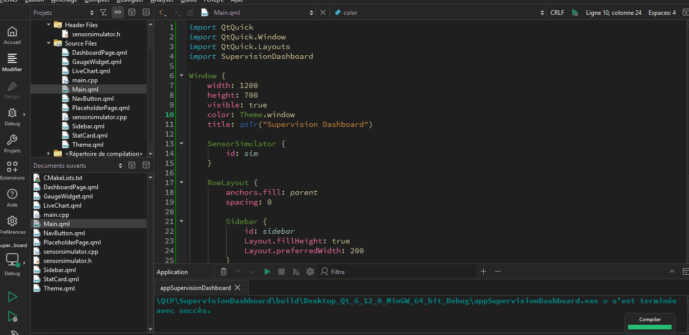

# SupervisionDashboard

Industrial supervision dashboard built with Qt 6, QML and C++ (simulated data)

Desktop application that monitors a simulated electrical installation
in real time: live measurements, alarms and history.

Built with **Qt 6**, **QML** and **C++**. No hardware required: a
built-in simulator replaces the sensors.

## Status

Work in progress. Done: live simulator, real-time charts (Qt Graphs),
temperature gauge, sidebar navigation, light/dark theme.
Next: alarms, SQLite history and settings.

## Planned features

* Real-time measurements: voltage, current, power, temperature
* Live chart (60 s sliding window) and temperature gauge
* Alarms with Warning / Critical levels, hysteresis and acknowledgment
* History stored in SQLite, with CSV export
* Settings saved between sessions
* Fault injection buttons to test alarms

## Tech stack

Qt 6.12, QML, C++17, CMake, SQLite (QtSql), Qt Test

## Build

Instructions coming soon.

## License

MIT

## Demo

