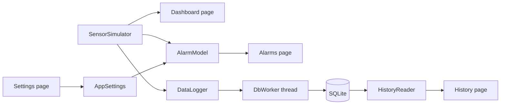

# Supervision Dashboard


A supervision dashboard for industrial installations, built with C++17 and Qt 6 (QML). It monitors **voltage, current, power and temperature** in real time with live charts and gauges. The measurements are **simulated**, so no hardware is required.

- **Dashboard:** live values, charts and a temperature gauge.
- **History page:** browse each quantity over a chosen time range on a line chart, and export the data to a CSV file.
- **Alarms page:** when a quantity crosses a threshold, the alarm log records the quantity, the time and the value. Once you have reviewed an alarm, you can acknowledge it.
- **Settings page:** set the warning and critical limits for each quantity. Your settings are saved for the next launch.


## Features

- Real-time monitoring of voltage, current, power and temperature
- Live charts (60-second sliding window) and an animated temperature gauge
- Warning and critical alarms with hysteresis, to avoid flickering around a threshold
- Alarm acknowledgment
- Measurement history stored in SQLite, with a time-range selector and CSV export
- Validated, persistent alarm thresholds for each quantity
- Fault-injection buttons to trigger alarms without hardware
- Light and dark themes
- Database writes run on a dedicated worker thread, so the UI never blocks

## Download

Download the latest version from the [Releases page](https://github.com/nourbelgacem077-byte/SupervisionDashboard/releases/latest) (Windows 64-bit), unzip it, and run `appSupervisionDashboard.exe`. No Qt installation is required.

> **Note:** Windows SmartScreen may show a warning because the executable is not code-signed. Click **More info → Run anyway** to launch the app.

## Tech stack

Qt 6, QML, C++17, CMake, SQLite (QtSql), Qt Graphs, Qt Test, GitHub Actions

## Architecture

The simulator generates voltage, current, power and temperature values in C++ every 100 ms and emits a signal for each update. The QML dashboard displays the values live. The same signal feeds the alarm model, which checks the values against configurable thresholds (with hysteresis) and raises alarms, and the data logger, which sends one sample per second to a worker thread that writes it to SQLite. The History page reads that database back. QML is used only for the user interface; all logic lives in C++.



## Build from source

**Prerequisites:** Qt 6.10 or later (with the **Qt Graphs** module), CMake, and a C++17 compiler.

1. Clone the repository:

```bash
git clone https://github.com/nourbelgacem077-byte/SupervisionDashboard.git
```

2. Open `CMakeLists.txt` in Qt Creator.
3. Select a kit, configure the project, and click **Run**.

## Run the tests

Unit tests (Qt Test) cover the alarm hysteresis logic, the alarm manager and its signals, and settings persistence. They also run automatically on every push through GitHub Actions.

To run them locally, from the project folder (adjust the Qt path to your installation; on Windows, add Qt's `bin` folder to your `PATH`):

```bash
cmake -S . -B build -DCMAKE_PREFIX_PATH=/path/to/Qt/6.x/gcc_64
cmake --build build --target tst_alarmrule tst_alarmmanager tst_appsettings
ctest --test-dir build --output-on-failure
```

## Roadmap

- v2: MQTT data source and multi-device supervision
- French / English translation

## License

MIT
